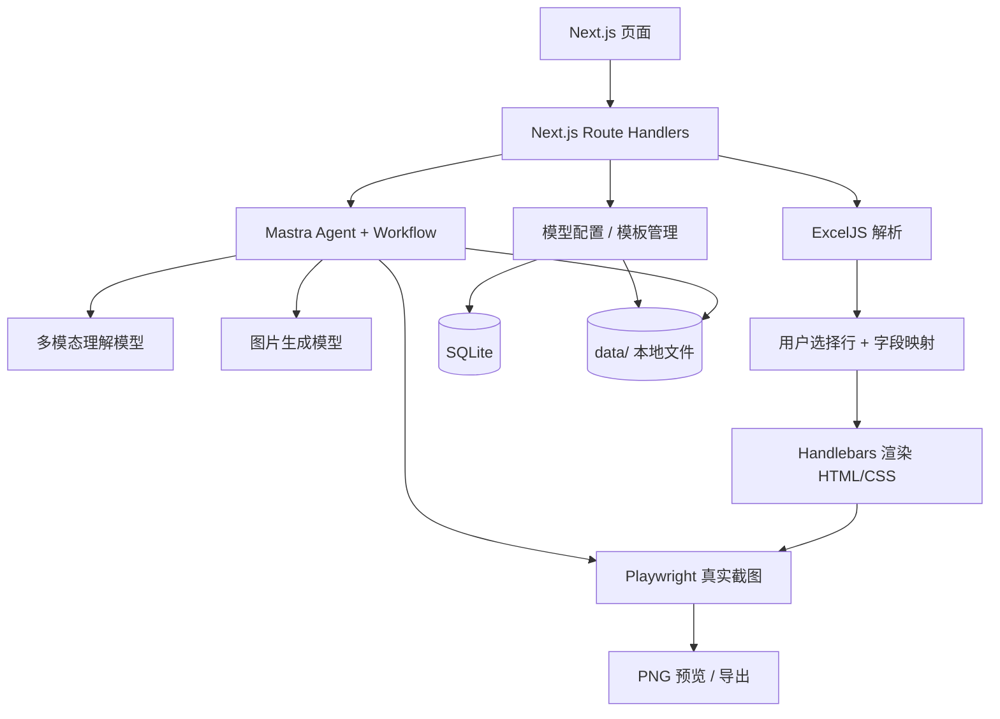

# AI Design — 技术设计文档

> 状态：**已实施** · 日期：2026-11-11 · 对应需求：[requirements.md](requirements.md)
>
> 当前仓库为空，本文是待实施设计，不表示已经开发完成。**不分阶段**，实现时一次完成所有已确认范围；不扩展未获批准的功能。

## 1. 技术选型（确定方案）

| 关注点 | 技术 | 原因 |
| --- | --- | --- |
| Web / API | **Next.js + TypeScript** | 前后端同仓、Node.js 服务端渲染与 API 路由，部署简单 |
| UI | Mantine UI + 少量布局 CSS | 快速实现设置、表格、模板库与图片预览 |
| Agent | **Mastra (`@mastra/core`)** | 现成 Agent、Tools、Workflow 及调试能力；不自造 Agent 循环 |
| 模型适配 | `@ai-sdk/openai-compatible`，按 Mastra 官方 Custom Gateway/Provider 扩展点连接 | 支持用户自定义 Base URL / API Key / Model ID，避免绑定单一厂商 |
| 图片生成 | AI SDK 的 `generateImage` / 兼容图片接口 | 与多模态理解模型独立配置；上游必须实际支持所调用接口 |
| Excel | **ExcelJS** | 服务端解析 `.xlsx` 的工作表、表头与单元格 |
| 数据模板 | **Handlebars** | `{{title}}`、`{{#each items}}` 等简单、稳定的变量填充 |
| 海报预览与导出 | **Playwright Chromium** | 真实浏览器渲染 HTML/CSS，PNG 截图；预览和导出共用同一渲染逻辑 |
| 元数据 | **SQLite + better-sqlite3** | 内部单实例，少依赖、无需启动数据库服务 |
| 文件 | **本地文件系统** `data/` | 保存模板源文件、素材、预览、海报；不引入对象存储 |
| API 参数校验 | **Zod** | 仅在 HTTP/API、Excel 导入、AI 产物落库等外部边界校验一次 |
| 测试 | Vitest + Playwright | 真实解析、填充、渲染与接口联调，尽量不用 mock |

开发使用 Node.js 22 LTS 或更高受支持版本；依赖采用**安装时验证过的兼容版本，并提交锁文件**，不在代码中写猜测的版本组合。

参考文档：
- Mastra：https://mastra.ai/docs
- Mastra + Next.js：https://mastra.ai/integrations/frameworks/next-js
- AI SDK OpenAI Compatible：https://ai-sdk.dev/providers/openai-compatible-providers
- Screenshot-to-code（设计参考，不直接搬入大型编辑器）：https://github.com/abi/screenshot-to-code
- Screenshot-to-HTML（截图反馈思路）：https://github.com/sevzq/screenshot-to-html

## 2. 运行架构



**单个 Next.js Node.js 服务运行 Mastra**：Next.js API Route 调用同进程的 Mastra Agent/Workflow，Playwright 在服务器本地启动 Chromium。无需额外 Python 服务、Redis、队列、调度平台或多个微服务。

### 2.1 Agent 与 Workflow 责任划分

采用一个 `templateAgent`，不开发多 Agent 协调系统。

- **Mastra Agent**：看图片、理解设计结构、生成 HTML/CSS/manifest，分析截图并按用户指令改稿。
- **Mastra Workflow**：按确定顺序串起「准备参考图 → Agent 生成模板 → 浏览器截图 → Agent 检查并必要时修改 → 返回预览」；使用框架原生 Workflow 执行与状态管理，**不手写自定义 ReAct/tool-calling 推理循环**。
- **确定性业务代码**：Excel 解析、列映射、Handlebar 填充、文件保存、PNG 导出，不交给 Agent 推理。

一个模板创建任务允许最初生成与**至多 2 次自动视觉修正**。超过后把真实预览交给用户，用自然语言发起下一次修改；这用于控制无限循环与 API 费用，不加分布式任务管理。

### 2.2 多模态模型接入

用户分别在设置页保存两套配置：

```json
{
  "vision": {
    "baseURL": "https://gateway.example.com/v1",
    "modelId": "your-vision-model",
    "apiKey": "<server-side only>"
  },
  "image": {
    "baseURL": "https://gateway.example.com/v1",
    "modelId": "your-image-model",
    "apiKey": "<server-side only>"
  }
}
```

说明：这里是字段结构示意，不是真实服务地址或密钥。配置实际保存到本机 SQLite，仅在服务端读取；页面只显示 API Key 已设置与否，**不回传完整密钥**，绝不写进 Git 或生成模板。

- 多模态理解优先用 OpenAI 兼容的 Chat Completions 图片输入和 Agent 工具调用。
- 通过 Mastra 支持的 Provider/Custom Gateway 接入自定义兼容服务；在创建 Agent 时读取当前用户已保存模型配置，而不是在代码中写死模型 ID。
- 图片生成通过兼容图片接口调用；仅针对实际验证支持该接口的模型启用该功能。若上游采用非兼容的特殊视频/生图协议，不擅自开发供应商专属适配器。
- 设置页提供「测试多模态图片识别与工具调用」「测试图片生成」两项真实调用，结果直接显示。

## 3. 模板数据协议

模板以目录为单位保存，**HTML/CSS 与素材文件是 AI 生成的最终源头产物**；人需要修改时重新发指令由 Agent 生成，不手改生成文件。

```text
data/
  ai-design.sqlite
  templates/
    <template-id>/
      template.html
      style.css
      manifest.json
      thumbnail.png
      assets/
        ...
  drafts/
    <draft-id>/
      ...
  exports/
    <generated-poster>.png
```

示例 `manifest.json`：

```json
{
  "name": "暗黑科技 · 模型促销",
  "width": 1080,
  "height": 1440,
  "fields": [
    { "key": "title", "type": "text", "label": "主标题" },
    { "key": "subtitle", "type": "text", "label": "副标题" },
    { "key": "items", "type": "list", "label": "模型卡片" },
    { "key": "qrcode", "type": "image", "label": "二维码" }
  ],
  "listFields": {
    "items": [
      { "key": "name", "label": "模型名称" },
      { "key": "displayPrice", "label": "展示价格" },
      { "key": "discount", "label": "折扣文案" }
    ]
  }
}
```

`displayPrice`、`discount` 只是模板内容示例，**不代表 Excel 已经有这些列**。模板字段和 Excel 字段通过映射连接，而不是把采购表结构写死在 HTML 中。

`template.html` 使用 Handlebars：

```html
<section class="poster">
  <h1>{{title}}</h1>
  <p>{{subtitle}}</p>
  <div class="cards">
    {{#each items}}
      <article class="card">
        <h2>{{name}}</h2>
        <strong>{{displayPrice}}</strong>
        <span>{{discount}}</span>
      </article>
    {{/each}}
  </div>
</section>
```

**限制仅生成静态 HTML/CSS 模板，不支持执行任意模板 JavaScript**。这一产品约束既减少生成结果的不确定性，也使运行逻辑简单。素材使用本地路径；原参考图中的文字不能直接作为不可替换的底图文字保留。

### 3.1 渲染输入

Excel 映射后的运行时数据结构（示意）：

```json
{
  "title": "热门模型优惠",
  "subtitle": "AI 模型限时活动",
  "items": [
    { "name": "模型 A", "displayPrice": "¥6.90", "discount": "优惠价" },
    { "name": "模型 B", "displayPrice": "¥3.50", "discount": "活动价" }
  ],
  "qrcode": "/assets/qr.png"
}
```

这些是**临时示意值**，不是任何实际平台价格。Excel 中什么是售价、采购价、折扣，待正式格式确定后才绑定和计算。默认由用户选择对外展示的数据列，避免把采购成本误当宣传报价。

## 4. Excel 导入与数据映射

`POST /api/excel/import` 读取 `.xlsx`，返回 sheet 列表、列名和记录数组。用户在页面选择需要的 sheet/行，然后配置字段绑定：

```json
{
  "templateId": "t_001",
  "sheetName": "Sheet1",
  "selectedRows": [2, 5],
  "mapping": {
    "items.name": "模型名称列",
    "items.displayPrice": "展示价格列"
  },
  "fixedFields": {
    "title": "新品模型活动"
  }
}
```

字段绑定可来自实际 Excel 表头；重复区 `items` 用所选行生成数组。未来用户提供固定 Excel 规范后，可以加入**同一映射逻辑的预设表头**，而不是重写导入架构。

- 只支持 `.xlsx`，用 ExcelJS 获取表格实际值。
- 入参文件尺寸、类型、必要表头等在**导入入口**检查一次；内部解析成确定的 `ImportedSheet` 类型后不重复做“万一是 null”的防御。
- 不偷偷计算模型利润或折扣；不自动发布采购价。
- 若用户改变宣传模型排序，只调整选中行的顺序，之后照顺序渲染。

## 5. API 设计

| 方法与路径 | 职责 |
| --- | --- |
| `GET/PUT /api/model-config` | 读取/保存两类模型配置（GET 不返回 API Key） |
| `POST /api/model-config/test` | 指定模型真实能力测试 |
| `POST /api/images/generate` | 文字提示词 → 生成参考设计图片 |
| `POST /api/templates/generate` | 参考图 / 生图结果 + 用户描述 → Mastra 转 HTML 模板草稿与预览 |
| `POST /api/templates/:id/revise` | 自然语言修改模板 → 重新生成并预览 |
| `GET/POST /api/templates` | 模板列表 / 保存确认后的草稿 |
| `GET/PATCH/DELETE /api/templates/:id` | 查看 / 重命名或复制等元数据操作 / 删除 |
| `POST /api/excel/import` | 解析 Excel，供页面选择行列 |
| `POST /api/posters/render` | 模板 ID + 数据绑定 → Playwright PNG，支持预览和下载 |

API 路径描述的是职责边界；不为每个内部辅助函数单独建接口。生成任务同步提供步骤状态/运行结果，不额外引入队列或常驻任务调度系统。

## 6. 核心代码目录

```text
src/
  app/
    (dashboard)/
      create/            # AI 生图、上传图、转模板和修改
      templates/         # 模板库
      posters/           # Excel 数据选择和海报导出
      settings/          # 两种模型配置
    api/                 # HTTP 入口和接口参数校验
  mastra/
    index.ts             # Mastra 实例注册
    agents/
      template-agent.ts  # 唯一模板 Agent
    workflows/
      create-template.ts # 创建、截图反馈、修改的框架流程
    tools/
      render-preview.ts  # 真正调用 Playwright，返回预览素材
  lib/
    excel.ts             # 读取 xlsx 并转换内部数据
    template.ts          # Handlebars 编译及填充
    render.ts            # Playwright 渲染 PNG
    model-provider.ts    # Mastra/provider 配置读取与接入
    storage.ts           # SQLite / 本地文件持久化
  components/            # 真实复用的页面组件
  types/                 # 业务数据类型
  tests/                 # Excel、模板、Playwright 的真实测试
  styles/

data/                    # 本机运行数据，加入 .gitignore
```

**函数与模块不预先过度抽象**：一个概念/复杂逻辑或两个调用方以上需要复用才抽成函数/模块。主要业务入口展示正常流程；校验与实现细节在子函数中完成。

## 7. 数据库与文件职责

SQLite 仅保存轻量元信息，最少两张表：

- `model_configs`：`kind`（vision/image）、`base_url`、`model_id`、`api_key`。
- `templates`：`id`、`name`、`width`、`height`、`folder_path`、`thumbnail_path`、`created_at`。

模板的 `HTML/CSS/manifest/assets` 存文件系统，不在数据库再存第二份源文件；生成的 PNG 存在 `data/exports`。Excel 导入只在当前会话用于填充，不引入复杂的长期数据集管理。

## 8. 真实渲染方案

1. 根据已选模板加载 HTML、CSS、manifest 与本地素材。
2. 将 Excel 绑定结果一次性转换成模板字段对象。
3. `Handlebars.compile` 渲染 HTML（普通变量默认 HTML 转义）。
4. Playwright 创建与模板一致的 viewport，加载填充后的静态页面与 CSS，等待字体与图片加载完成。
5. 页面截图导出 PNG；将同一 PNG 用于预览、检查和下载。

预览使用 iframe 时不启用 JavaScript；服务端 Chromium 使用静态 HTML/CSS 渲染。这属于**静态模板这一产品格式的必要约束**，不是额外的复杂通用安全防护系统。

**视觉效果约束**：保持参考图的构图、层次、留白、立体装饰与颜色风格；动态内容应是真实 DOM 文本或图片槽位，不得用原参考图的数字遮盖再叠新数字。Agent 根据渲染预览修正时优先改生成源文件，再重新截图。

## 9. 测试与交付

### 9.1 自动化测试（少 mock）

- ExcelJS 读取实际 `.xlsx` fixtures，断言列名、单元格值、选择行与排序结果。
- Handlebars 用真实模板文件和真实输入对象渲染，断言动态字段和重复项。
- Playwright 加载真实 HTML/CSS 后截图，检查 PNG 生成成功、尺寸正确、文本真实存在于 DOM。
- 模板保存、复制、重命名、删除使用真实临时 SQLite 与临时文件目录。
- 对 API Route 做真实请求测试，尽量不 mock 内部服务。
- AI 能力用**人工配置的实际 API Key**进行联调/端到端测试；不以 mock 的成功返回替代真实模型效果。

### 9.2 完整交付标准（非阶段计划）

项目代码、README、安装说明、`.env.example`、样例模板、实际 XLSX 测试数据、可运行 Web 页面、模型配置、两种转模板入口、模板管理、Excel 映射、PNG 预览导出、测试脚本必须**一次完整交付**，并能按说明在本地运行。

## 10. 强制开发约束

以下规则适用于整个项目的实现与后续维护：

1. **不扩大需求**：不为了推测的极小概率竞态、边界、兼容问题提前加机制。如认为必须加防护，先说明具体故障路径、发生概率判断、预计新增代码行数及维护成本，得到用户同意后实施。
2. **仅入口校验一次**：HTTP 请求、Excel 文件和 AI 生成结果作为外部输入进行必要校验；内部确定类型后不反复检查。
3. **不提前抽象**：仅当逻辑复用、复杂或具备独立业务概念时抽函数/组件；只用一次的短逻辑留在调用处。
4. **主流程清晰**：主函数只描述正常业务流；校验、数据转换和细节操作放到有明确职责的子函数中。
5. **注释克制**：仅写非直观约束、反直觉实现原因，不给显而易见的代码加注释。
6. **AI 生成物不可手工修补**：发现生成 HTML/CSS/manifest 问题，应改 Prompt、Agent 约束或生成输入，重新生成，不能手工在生成结果中打补丁。
7. **真实实现测试**：不将业务实现复制到测试中，减少 mock，能运行真实文件/渲染器就运行真实文件/渲染器。
8. **一次完整交付**：不以 MVP、一期二期拆分承诺，不增加未经用户批准的功能。

## 11. 需要用户确认、不能凭空定论的点

- 正式 Excel 列格式与售价/折扣展示逻辑尚未提供。代码以字段映射为输入，但**不实现臆测的价格公式**。
- 默认服务只在可信内部环境使用。若对互联网直接开放，API Key 管理、登录权限和可执行内容暴露问题需要**单独评估并征得同意**，不默默增加认证/复杂审计系统。
- AI 生成的 HTML 对任意参考图无法保证像素级复原。以可编辑字段、视觉精美度、正常浏览器渲染为验收目标。

待上述需求确认后，实施时以这两份文档为边界，不擅自追加技术组件或后台服务。

## 统一创作 Agent 及数据模型（2026-11-11）

`/api/studio` 负责加载历史、接收多模态消息、运行 Mastra Agent 和保存设计状态。`designStudioAgent()` 注册 `generateImage`、`convertToTemplate`、`reviseTemplate`、`saveTemplate` 四个 Mastra Tools。它们复用 `src/lib/design-operations.ts` 和已有 Mastra 模板 Workflow，不引入自研 Agent 循环。

SQLite `studio_states` 表按聊天会话 ID 存储 `reference_path`、`draft_id`、`template_id`、`width`、`height`；原 `chat_messages` 存储对话，页面恢复时一次取得这两类数据。原模板库、Excel/PNG 路由保持不变。

`/create` 使用 Mantine 三栏布局：创作会话、对话操作区、参考图与 HTML 预览。旧 `/chat` 重定向。CI 通过模拟浏览器点击，并使用本地 OpenAI 兼容服务代替外部收费模型，调用真实 Mastra 工具链来检查转换、保存和刷新恢复。

## 持续执行与可观测性（2026-11-11）

- Mastra Agent.stream() 在 Node 服务端独立执行，SSE 连接仅负责订阅进度；任务与事件分别保存到 SQLite studio_runs、studio_events。
- GET /api/studio/runs/[id]/events 支持事件 ID 重连补发。文本增量、工具调用、实际可用的模型推理、Token 用量均来自 SDK 事件，不伪造思考过程。
- 最近 12 条消息提供模型上下文，旧图片历史仍保存在本地但不反复编码进每轮请求。
- Mastra Workflow.stream() 提供模板生成步骤进度；首次 HTML 输出提前落盘，视觉修正失败时仍可使用初稿。
- AI 生成产物在入口校验实际 Handlebars 模型名称和折扣占位符；修改模板之前将原版存至 versions/，恢复时也保存恢复前版本。
- poster_draft 保存海报编辑选择与文案；备份脚本同步备份版本目录。
- 单进程内后台任务不会因浏览器切页取消，进程重启会标记 interrupted，由用户决定是否继续，未引入外部队列。
